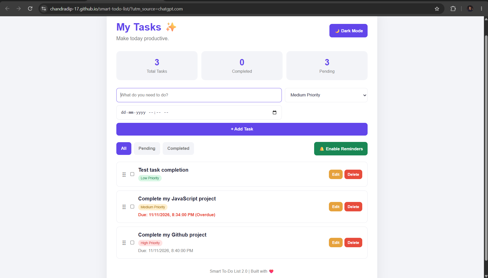

# Smart To-Do List 2.0 🚀

A modern, responsive task management web application built using **HTML, CSS, and Vanilla JavaScript**. Organize your daily activities, manage priorities, set deadlines, and stay productive with a clean and intuitive interface.

🔗 **Live Demo:** https://chandradip-17.github.io/smart-todo-list/

## ✨ Features

- ➕ **Add Tasks** – Quickly create new tasks.
- ✏️ **Edit Tasks** – Update task details whenever needed.
- 🗑️ **Delete Tasks** – Remove tasks you no longer need.
- ✅ **Mark as Complete** – Track your completed activities.
- 🎯 **Task Priorities** – Organize tasks by priority levels.
- 🔍 **Task Filters** – View all, pending, and completed tasks.
- 📊 **Task Statistics** – Track your productivity.
- 🌙 **Dark Mode** – Switch between light and dark themes.
- 📅 **Due Dates** – Set deadlines for your tasks.
- 🔔 **Browser Notifications** – Receive task reminders while the app is open and notifications are permitted.
- 🖱️ **Drag and Drop** – Rearrange tasks easily.
- 💾 **Local Storage** – Keep tasks saved in your browser.
- 📱 **Responsive Design** – Works across desktop, tablet, and mobile devices.

## 🛠️ Technologies Used

- HTML5
- CSS3
- JavaScript (Vanilla JS)
- Browser Local Storage API
- Browser Notifications API
- HTML Drag and Drop API

## 📂 Project Structure

```text
smart-todo-list/
│
├── index.html
├── style.css
├── script.js
└── README.md
```

## 🚀 Getting Started

### 1. Clone the repository

```bash
git clone https://github.com/chandradip-17/smart-todo-list.git
```

### 2. Open the project folder

```bash
cd smart-todo-list
```

### 3. Run the application

Open `index.html` in your web browser.

For the best experience, you can also run it using VS Code with the Live Server extension.

## 🌐 Live Demo

Try the application here:

**[Smart To-Do List – Live Website](https://chandradip-17.github.io/smart-todo-list/)**

## 📸 Screenshots

### Light Mode


```

## 🔮 Future Improvements

- User authentication
- Cloud-based task synchronization
- Task categories and labels
- Search functionality
- Calendar view
- Improved notification scheduling

## 🤝 Contributing

Contributions, suggestions, and feature requests are welcome!

Feel free to fork this repository and submit a pull request.

## 👨‍💻 Author

**Chandradip**

- GitHub: [@chandradip-17](https://github.com/chandradip-17)

## 📄 License

This project is open source and available under the [MIT License](LICENSE).

---

⭐ If you like this project, consider giving it a star on GitHub!

**Organize smarter. Stay productive. Get things done.**
