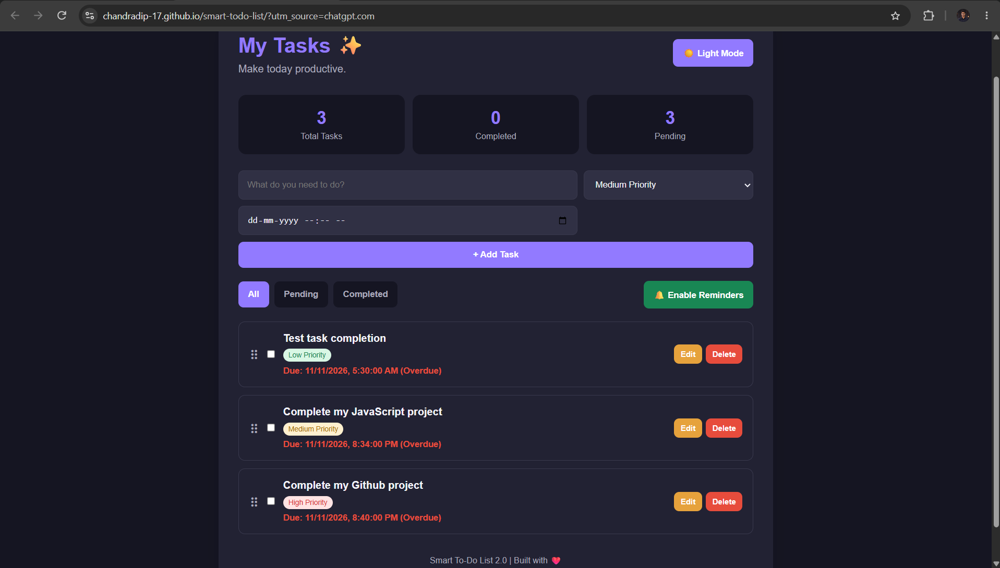

# Smart To-Do List 2.0 🚀

<p align="center">
  A modern, responsive task management application built with HTML, CSS, and Vanilla JavaScript.
</p>

<p align="center">
  <a href="https://chandradip-17.github.io/smart-todo-list/">
    <strong>🚀 Live Demo</strong>
  </a>
</p>

<p align="center">
  
  
  
  
</p>

---

## 📌 About The Project

**Smart To-Do List 2.0** is a simple yet powerful task management web application designed to help users organize their daily activities and stay productive.

It provides an intuitive interface for creating, editing, deleting, prioritizing, and tracking tasks, along with useful features such as dark mode, due dates, browser notifications, and task statistics.

The application is built using **HTML5, CSS3, and Vanilla JavaScript**, with browser Local Storage used to save tasks between sessions.

## ✨ Features

- ➕ **Add Tasks** – Quickly create new tasks.
- ✏️ **Edit Tasks** – Update task details whenever needed.
- 🗑️ **Delete Tasks** – Remove tasks you no longer need.
- ✅ **Mark as Complete** – Track completed activities.
- 🎯 **Task Priorities** – Organize tasks by priority levels.
- 🔍 **Task Filters** – View all, pending, and completed tasks.
- 📊 **Task Statistics** – Track your productivity.
- 🌙 **Dark Mode** – Switch between light and dark themes.
- 📅 **Due Dates** – Set deadlines for your tasks.
- 🔔 **Browser Notifications** – Receive reminders while the application is open and notification permission is granted.
- 🖱️ **Drag and Drop** – Rearrange tasks easily.
- 💾 **Local Storage** – Save tasks and preferences in your browser.
- 📱 **Responsive Design** – Enjoy a user-friendly experience across desktop, tablet, and mobile devices.

## 🛠️ Technologies Used

| Technology | Purpose |
|---|---|
| HTML5 | Application structure |
| CSS3 | Styling, layouts, and responsive design |
| JavaScript (Vanilla JS) | Application functionality |
| Local Storage API | Persistent browser-side data |
| Notifications API | Browser reminders |
| HTML Drag and Drop API | Task reordering |

## 📸 Screenshots

### ☀️ Light Mode


### 🌙 Dark Mode



## 📂 Project Structure

```text
smart-todo-list/
│
├── index.html
├── style.css
├── script.js
├── README.md
└── screenshots/
    ├── homepage.png
    └── dark-mode.png
```

## 🚀 Getting Started

Follow these steps to run the project locally.

### 1. Clone the repository

```bash
git clone https://github.com/chandradip-17/smart-todo-list.git
```

### 2. Navigate to the project folder

```bash
cd smart-todo-list
```

### 3. Run the application

Open `index.html` in your web browser.

Alternatively, use the **Live Server** extension in Visual Studio Code for a convenient local development experience.

## 🌐 Live Demo

Experience the application here:

**[Smart To-Do List 2.0 – Live Website](https://chandradip-17.github.io/smart-todo-list/)**

## 🔮 Future Improvements

Some features planned for future versions include:

- 🔐 User authentication
- ☁️ Cloud-based task synchronization
- 🏷️ Task categories and labels
- 🔎 Search functionality
- 📅 Calendar view
- 🔔 Improved background notification scheduling

## 🤝 Contributing

Contributions, suggestions, and feature requests are welcome!

If you'd like to contribute:

1. Fork this repository.
2. Create a new branch for your changes.
3. Commit your changes.
4. Push your branch.
5. Open a Pull Request.

## 👨‍💻 Author

**Chandradip**

- GitHub: [@chandradip-17](https://github.com/chandradip-17)

## 📄 License

This project is intended to be available under the MIT License. See the [LICENSE](LICENSE) file for details.

---

⭐ If you find this project useful, consider giving it a star on GitHub!

**Organize smarter. Stay productive. Get things done.**